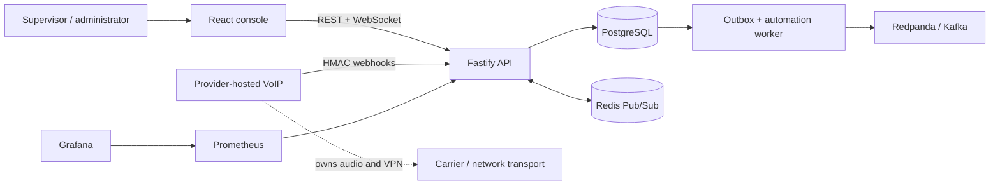
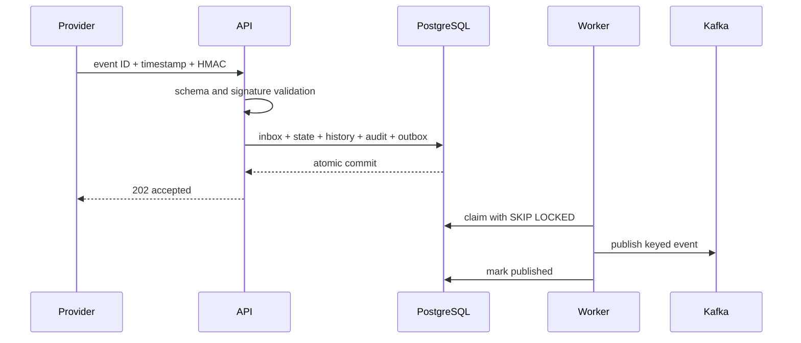

# RelayOps — Secure Contact Center Control Plane

[](https://github.com/dragon122177/secure-contact-center-control-plane/actions/workflows/ci.yml)
[](https://github.com/dragon122177/secure-contact-center-control-plane/actions/workflows/codeql.yml)
[](https://www.typescriptlang.org/)
[](LICENSE)

RelayOps is a provider-neutral operations platform for configuring and observing a secure contact
center. It combines skill-aware call routing, twelve-agent workforce state, signed provider events,
automation, VPN/proxy policy metadata, realtime dashboards, and append-only audit evidence.

The project is a technical reconstruction inspired by hands-on contact-center configuration work.
All companies, agents, calls, phone numbers, credentials, and network ranges are fictional.

> **Scope boundary:** RelayOps is the control plane. A third-party provider remains responsible for
> VoIP/SIP/RTP transport and VPN/proxy tunnels. RelayOps does not store call audio and does not
> implement billing.

## Why this project exists

Operating a small contact center is more than rendering a list of agents. Provider events retry,
calls arrive out of order, an assignment must respect skills and capacity, operator changes need an
evidence trail, and downstream systems cannot lose an event when Kafka is briefly unavailable.

RelayOps makes those failure cases explicit:

- HMAC-signed, replay-bounded provider webhooks;
- idempotent inbox and transactional outbox;
- validated call-state machine with safe queue fallback;
- deterministic skill-and-idle routing;
- event-driven automations with bounded retries;
- PostgreSQL as the durable source of truth;
- Redis WebSocket fan-out with polling fallback;
- Kafka-compatible domain events keyed by call;
- RBAC, rate limiting, log redaction, and append-only audit evidence;
- Prometheus metrics, a provisioned Grafana dashboard, CI, and Kubernetes manifests.

## Architecture



The webhook transaction commits inbox deduplication, call state, ordered history, routing outcome,
audit evidence, and the outgoing domain event together. The worker publishes later with
at-least-once semantics; consumers deduplicate by event ID.

[Read the full architecture](docs/architecture.md) ·
[Explore the data model](docs/data-model.md) ·
[Review the provider contract](docs/provider-integration.md)

## Feature map

| Area           | Demonstrated behavior                                                                   |
| -------------- | --------------------------------------------------------------------------------------- |
| Live wallboard | Agent capacity, calls, queue pressure, recent evidence, WebSocket invalidation          |
| Agents         | Twelve fictional agents, teams, extensions, skills, manual/provider-owned presence      |
| Routing        | Required and preferred skills, free capacity, idle-time score, deterministic tie-break  |
| Calls          | Inbound lifecycle, masked caller UI, ordered events, terminal-state protection          |
| Automations    | Conditions, tag/disposition/notification actions, worker retries and failure visibility |
| Network access | Provider VPN/proxy CIDRs, managed-device posture, recorded allow/deny decisions         |
| Security       | JWT RBAC, bcrypt, HMAC, rate limits, CORS, Helmet, parameterized SQL, redacted logs     |
| Reliability    | Inbox/outbox, row locking, `SKIP LOCKED`, exponential backoff, health checks            |
| Observability  | Prometheus runtime/business metrics, Grafana dashboard, correlation IDs                 |
| Delivery       | Multi-stage containers, Compose, Kubernetes, HPA/PDB/network policy, CI and CodeQL      |

## Technology

- **API and worker:** Node.js 22, TypeScript, Fastify, Zod, `pg`, KafkaJS, ioredis
- **Web:** React 19, Vite, TanStack Query, History API routing, Lucide
- **Data:** PostgreSQL 16, Redis 7, Redpanda (Kafka-compatible)
- **Operations:** Docker Compose, Kubernetes, Prometheus, Grafana, GitHub Actions, CodeQL
- **Testing:** Vitest, Testing Library, PostgreSQL integration tests

## Run the complete stack

Requirements: Docker Engine with Compose v2.

```bash
git clone https://github.com/dragon122177/secure-contact-center-control-plane.git
cd secure-contact-center-control-plane
cp .env.example .env
docker compose up --build
```

Open `http://localhost:3000` and use the synthetic local account:

```text
admin@relayops.local
RelayOps!2026
```

Supporting services:

| Service          | URL                                  | Local credentials    |
| ---------------- | ------------------------------------ | -------------------- |
| RelayOps console | `http://localhost:3000`              | shown above          |
| API readiness    | `http://localhost:8080/health/ready` | none                 |
| Prometheus       | `http://localhost:9090`              | none                 |
| Grafana          | `http://localhost:3001`              | `admin` / `relayops` |

The `migrate` container applies checksum-protected migrations and loads one synthetic workspace,
twelve agents, queues, skills, policies, automation rules, and sample calls.

## Run in local development

Start PostgreSQL, Redis, and Redpanda, then:

```bash
npm ci
npm run db:migrate
npm run db:seed
npm run dev
npm run dev:worker
```

The API uses port `8080`; Vite uses `5173`. Configuration is documented in `.env.example`.

## Send a signed provider event

The sample helper refreshes the timestamp and event ID, signs the canonical JSON locally, and sends
it to the fictional workspace:

```bash
npm run demo:webhook -- samples/call-received.json
```

Then send later lifecycle fixtures using the same provider call ID. The complete event and signature
contract is in [provider-integration.md](docs/provider-integration.md). The HTTP interface is defined
in [OpenAPI 3.1](docs/openapi.yaml).

## Call and event reliability



If the same provider event arrives twice, the unique inbox key returns a successful duplicate
acknowledgement without repeating side effects. If the worker dies after Kafka acknowledges but
before PostgreSQL records success, a duplicate publish is possible by design—downstream consumers
must use the durable outbox event ID for deduplication.

## Security and privacy boundary

The repository contains only synthetic data and documentation-only IP ranges. Phone numbers are
masked in the console, sensitive log fields are redacted, and no audio is stored. Kubernetes examples
reference external managed data services and a placeholder secret; real secrets must come from a
secret manager.

This is a portfolio reference, not a certified production telephone system. The documented
[security model](docs/security-model.md) separates implemented controls from the hardening required
before real use.

## Quality gates

```bash
npm run check
```

The command checks formatting, linting, TypeScript, tests, and both production builds. CI also starts
PostgreSQL, runs migrations and the integration seed, enforces coverage for core decision logic,
audits production dependencies, builds both containers, and runs CodeQL.

Core tests cover:

- valid, optional, repeated, and forbidden call transitions;
- required/preferred skill routing and queue fallback;
- CIDR boundaries and invalid network inputs;
- automation condition evaluation;
- valid, tampered, stale, and malformed webhook signatures;
- database seed and inbox uniqueness;
- accessible UI status and empty-state primitives.

See [testing.md](docs/testing.md) for the test strategy and expansion plan.

## Repository layout

```text
apps/
  api/                  Fastify API, domain logic, workers, tests
  web/                  React operations console
database/
  migrations/           Forward-only, checksum-protected PostgreSQL migrations
docs/
  adr/                  Architecture decisions
  openapi.yaml          HTTP contract
infra/
  grafana/              Provisioned dashboard and datasource
  kubernetes/           Deployments, services, ingress, HPA, PDB, policies
  prometheus/           Scrape configuration
samples/                Signed webhook fixtures and sender
```

## Design decisions

- [ADR 0001: Keep provider transport outside RelayOps](docs/adr/0001-provider-control-plane-boundary.md)
- [ADR 0002: Use a transactional inbox and outbox](docs/adr/0002-transactional-inbox-outbox.md)
- [ADR 0003: PostgreSQL is authoritative; Redis is disposable](docs/adr/0003-postgres-source-of-truth.md)

Operational recovery procedures are in the [runbook](docs/operations-runbook.md).

## License

MIT — see [LICENSE](LICENSE).
