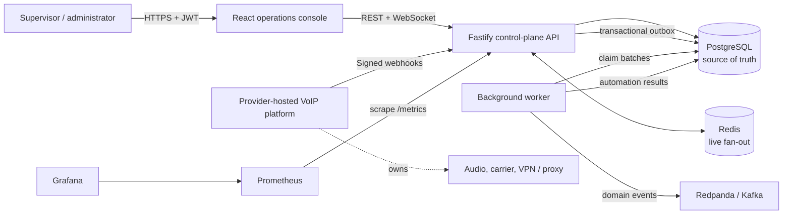

# Architecture

RelayOps is a provider-neutral **control plane** for a small contact center. It owns operational
configuration and decisions. It does not carry RTP audio, establish VPN tunnels, provision public
telephone numbers, or calculate invoices.

## System context



## Deployment units

| Unit       | Responsibility                                                     | Scaling axis             |
| ---------- | ------------------------------------------------------------------ | ------------------------ |
| `web`      | Static React application and reverse proxy                         | Request rate             |
| `api`      | Authentication, validation, routing, queries, webhook transactions | HTTP and webhook rate    |
| `worker`   | Outbox publication and automation execution                        | Backlog depth            |
| PostgreSQL | Durable operational source of truth                                | Transactions and storage |
| Redis      | Cross-instance realtime fan-out                                    | Connected dashboards     |
| Redpanda   | Kafka-compatible downstream event stream                           | Domain-event throughput  |

The API and worker are stateless. Multiple instances coordinate through PostgreSQL row locks and
`FOR UPDATE SKIP LOCKED` claims.

## Provider event path

```mermaid
sequenceDiagram
  autonumber
  participant P as VoIP provider
  participant A as RelayOps API
  participant DB as PostgreSQL
  participant R as Routing engine
  participant W as Worker
  participant K as Kafka

  P->>A: CALL_RECEIVED + timestamp + HMAC
  A->>A: Validate schema, signature, and timestamp
  A->>DB: BEGIN; insert webhook inbox key
  alt duplicate provider event ID
    DB-->>A: Unique conflict
    A-->>P: 200 duplicate acknowledged
  else new event
    A->>DB: Lock/create call and load queue candidates
    A->>R: Required skills + available capacity
    R-->>A: Stable agent decision or queue fallback
    A->>DB: Call events + agent reservation + outbox + audit
    A->>DB: COMMIT
    A-->>P: 202 accepted
    W->>DB: Claim outbox batch with SKIP LOCKED
    W->>K: Publish keyed domain event
    W->>DB: Mark event published
  end
```

## Consistency model

- **Strong inside one webhook:** inbox insert, call transition, routing assignment, call history,
  audit evidence, and outbox insert commit together.
- **At-least-once outside PostgreSQL:** the worker can publish an event more than once if it dies
  after Kafka acknowledges but before PostgreSQL records success. Consumers must deduplicate by
  outbox event ID.
- **Idempotent provider ingress:** `(workspace_id, provider_event_id)` is unique.
- **Ordered aggregate events:** Kafka messages use the call ID as the partition key.
- **Eventual dashboard refresh:** Redis pushes invalidation messages; 10–15 second polling is the
  fallback.

## Routing model

`SKILL_IDLE` uses an intentionally explainable score:

1. Remove agents who are not `AVAILABLE`, have reached capacity, or lack a required skill.
2. Add 100 points per preferred-skill match.
3. Add two points per idle hour, capped at 24 hours.
4. Add ten points per free concurrent-call slot.
5. Break equal scores by stable agent ID ordering.

The algorithm is pure TypeScript and covered by deterministic unit tests. A queue fallback is safer
than assigning an ineligible agent.

## State ownership

| State                                                 | Authoritative owner                     |
| ----------------------------------------------------- | --------------------------------------- |
| Call lifecycle and assignment history                 | PostgreSQL                              |
| Manual availability (`AVAILABLE`, `BREAK`, `OFFLINE`) | RelayOps control plane                  |
| Provider-driven presence (`RESERVED`, `ON_CALL`)      | Provider events interpreted by RelayOps |
| Cross-instance dashboard invalidation                 | Redis Pub/Sub                           |
| Downstream domain events                              | Kafka-compatible log                    |
| Audio and transport status                            | External provider; not stored here      |

## Failure behavior

- An invalid signature is rejected before a database transaction.
- An out-of-order call transition returns `409` and changes no call state.
- A database failure rolls back inbox, state, history, audit, and outbox together.
- A Kafka outage leaves events retryable in the outbox with exponential backoff.
- A failed automation is retried up to five times and then remains visible as `FAILED`.
- A Redis outage affects realtime push but not authoritative reads or writes.

See the [operations runbook](operations-runbook.md) for detection and recovery procedures.
