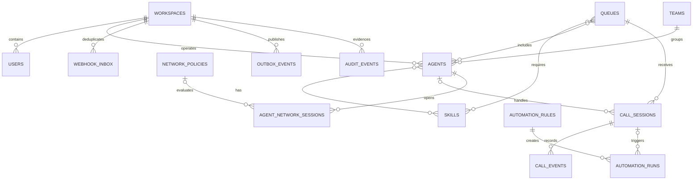

# Data model

RelayOps separates tables by business responsibility rather than placing every object in `public`.

## Schemas

| Schema       | Tables                                                  | Purpose                                       |
| ------------ | ------------------------------------------------------- | --------------------------------------------- |
| `identity`   | `workspaces`, `users`                                   | Tenant and operator identity                  |
| `routing`    | `teams`, `skills`, `agents`, memberships, queues, rules | Workforce and assignment configuration        |
| `calls`      | `call_sessions`, `call_events`                          | Current aggregate plus ordered history        |
| `automation` | `rules`, `runs`                                         | Event-driven actions and retry state          |
| `security`   | `network_policies`, `agent_network_sessions`            | Provider-access policy metadata and decisions |
| `events`     | `webhook_inbox`, `outbox_events`                        | Reliable ingress and egress                   |
| `audit`      | `audit_events`                                          | Append-only human/system evidence             |

## Important constraints

- Provider event IDs are unique per workspace.
- Provider call IDs, agent external IDs, extensions, queue keys, and emails are scoped by workspace.
- Agent capacity cannot be negative; maximum concurrent calls is bounded.
- Queue service and wait targets must be positive.
- Automation and outbox statuses use constrained values.
- CIDRs and source addresses use PostgreSQL `cidr` and `inet` types.
- Audit update/delete operations are rejected by trigger.
- Operational lookup paths have partial/composite indexes.

## Tenant isolation

Every operational aggregate carries `workspace_id`, and repository queries always filter it from the
authenticated token. This is application-enforced isolation suitable for the demonstration. A
production multi-tenant service should add PostgreSQL row-level security or separate databases,
then test cross-tenant denial at every endpoint.

## Migration policy

Files in `database/migrations` are ordered, checksum-protected, and applied under an advisory lock.
Changes are forward-only and additive whenever possible. Once a migration reaches a shared
environment, create a new migration instead of editing it.
